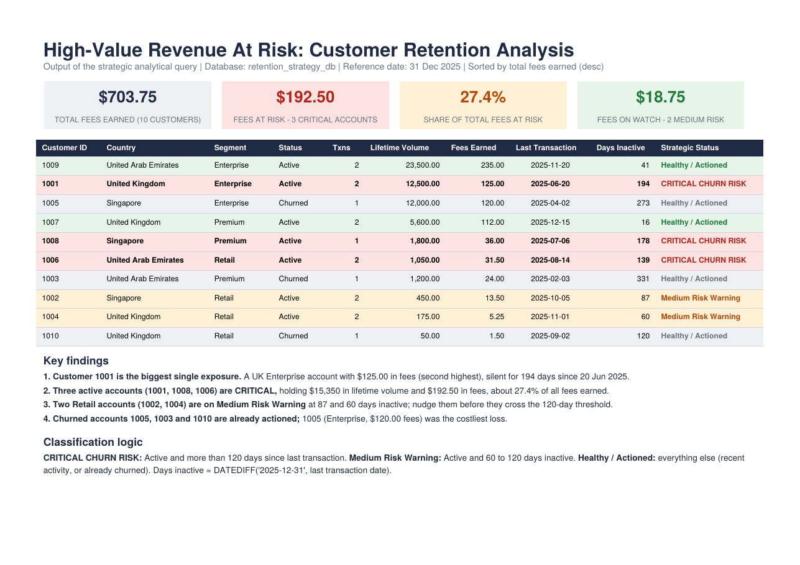
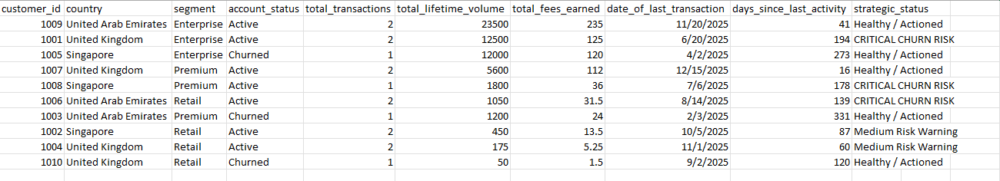

# Customer Retention Analysis (SQL)

A **MySQL** project that builds a small customer and transactions database, seeds it with mock data, and uses a single analytical query to find which active customers have gone quiet and how much fee revenue is at risk.

> **Business question:** Which active customers are at risk of churning, and how much revenue sits with them?
> **Answer:** 3 of 7 active customers have been inactive for 139 to 194 days. Together they account for **$192.50 in fees (27.4% of the total)**.

## Key findings

| Metric | Result |
|---|---|
| Customers and transactions | **10** customers (7 active, 3 churned) and **16** transactions |
| Total transaction volume | **$58,325**, generating **$703.75** in fees |
| Critical churn risk | **3 active customers**: 1001 (UK, Enterprise), 1008 (Singapore, Premium) and 1006 (UAE, Retail) |
| Revenue at risk | **$192.50 in fees (27.4%)** and $15,350 in volume |
| Biggest single risk | Customer **1001** (UK, Enterprise): $125 in fees, no activity for **194 days** |
| Medium risk | **2 active customers** (1002 at 87 days, 1004 at 60 days), $18.75 in fees |
| Already churned | **3 customers**, $145.50 in fees (20.7%) and $13,250 in volume |
| Top fee earner is healthy | Customer **1009** (UAE, Enterprise): $235 in fees, last active 20 Nov 2025 |

## Recommendations

1. **Contact customer 1001 first.** It is an Enterprise account worth $125 in fees and has been silent for 194 days.
2. **Re-engage 1008 and 1006.** Both are active but have been inactive for 178 and 139 days.
3. **Nudge the medium-risk accounts early.** Customers 1002 and 1004 are at 87 and 60 days, so a reminder now may stop them reaching the 120-day mark.
4. **Learn from the churned accounts.** Customers 1005, 1003 and 1010 each made a single transaction before leaving, so the first 90 days after signup are worth reviewing.

## Raw MySQL output

The result exactly as MySQL returned it, ordered by fees earned.

A formatted one-page version with summary cards is in [`docs/`](docs/Customer_Retention_Results.pdf).

## What I did in MySQL

**Database design**
- Created the `retention_strategy_db` database with a `customers` dimension table and a `transactions` fact table, linked by a foreign key on `customer_id`
- Seeded 10 customers (United Kingdom, Singapore and United Arab Emirates; Retail, Premium and Enterprise) and 16 transactions across 2025

**Analysis query**
- Joined customers to transactions with a `LEFT JOIN`, so customers with no transactions would still appear
- Counted transactions and summed volume and fees per customer with `COUNT` and `SUM`, and found the last transaction date with `MAX`
- Measured inactivity with `DATEDIFF` between 31 December 2025 (the reference date) and the last transaction date
- Ranked the results by fees earned, so the most valuable accounts come first

**Risk flags with `CASE WHEN`**
- **CRITICAL CHURN RISK:** active and inactive for more than 120 days
- **Medium Risk Warning:** active and inactive for 60 to 120 days
- **Healthy / Actioned:** everyone else, including accounts that have already churned

## Files

| File | Description |
|---|---|
| `retention_strategy_analysis.sql` | Creates the database and tables, loads the mock data and runs the analytical query |
| `docs/Customer_Retention_Results.pdf` | PDF of the query results with summary cards and findings |
| `images/` | The results page image and the raw MySQL output screenshot |

**How to run:** install MySQL 8 (or MariaDB), then run `retention_strategy_analysis.sql` in MySQL Workbench or the command line. It creates the database and tables, loads the data and runs the query. The syntax is MySQL-specific (`AUTO_INCREMENT` and the two-argument `DATEDIFF`), so it needs small changes for SQL Server or PostgreSQL.

## Skills demonstrated

Database and table design (`CREATE`, primary and foreign keys), `INSERT`, `LEFT JOIN`, `GROUP BY`, aggregate functions (`COUNT`, `SUM`, `MAX`), date arithmetic with `DATEDIFF`, conditional logic with `CASE WHEN`, `ORDER BY`, and turning query results into recommendations.

## About the data

The data is mock data I created for this project. It does not describe real customers.

## Contact

**Douglas Ogieva** | Benin City, Nigeria | [LinkedIn](https://www.linkedin.com/in/douglasogieva) | [Email](mailto:douglasogieva14@gmail.com)
